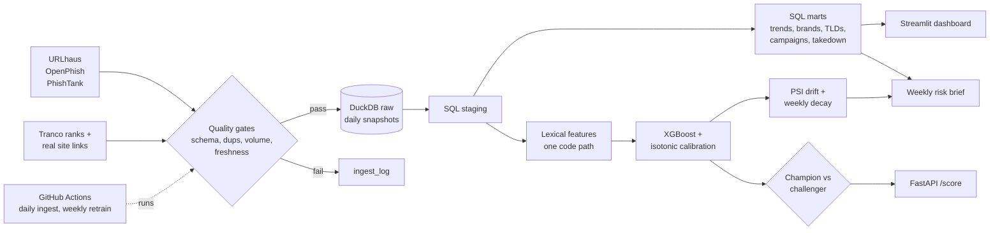

# AbuseLens: Malicious URL Detection & Abuse Trend Analytics

A pipeline that runs itself every day: it collects **real** malicious URLs from live abuse feeds, stores
them in a SQL warehouse (DuckDB), finds trends and attack campaigns, scores URLs with a calibrated
machine-learning model, and reports the way a Trust & Safety analyst would.

**What it found (real data, 21 Sep to 22 Oct 2026):**
- About 40% of the malware URLs are files hosted on **GitHub alone**, and Google Drive, Discord and Dropbox
  show up in the top campaigns. Attackers are abusing trusted platforms, so blocking by domain would not work.
- Median malware URL stays live **301 hours (about 12.5 days)**; 52% are still online after 7 days.
- Detector at a 1% false-positive budget catches **98.1% of malware**; precision at an assumed 1% real-world
  prevalence is **58.8%** (high AUC does not mean high precision when abuse is rare).
- Recall on genuinely unseen later weeks stayed flat (98.2% to 98.5%), so no model decay is visible yet.

Full write-up of decisions, bugs found and limits: [docs/interview_story.md](docs/interview_story.md).

## Architecture



## Data sources (no synthetic data in the pipeline)

| Source | Role |
|---|---|
| abuse.ch URLhaus | Malware URLs, added-date, online status → malicious examples **and** takedown-time data |
| OpenPhish free feed | Live phishing URLs |
| PhishTank | Verified phishing + impersonated brand (registration is currently closed; optional) |
| Tranco top-1M | Safe examples (sampled from rank 1,000–1,000,000, not the head) |
| Common Crawl URL index / site links | Real paths for the sampled safe domains (Common Crawl when up, otherwise internal links from each site's homepage) |
| RDAP, crt.sh, Team Cymru | Domain age, registrar, cert history, ASN (optional enrichment) |

> Test fixtures in `tests/` are generated rows used only to exercise code paths.

## Quick start

```bash
python -m venv .venv && source .venv/bin/activate      # Windows: .venv\Scripts\Activate.ps1
pip install -e ".[dev,dashboard]"
export ABUSECH_AUTH_KEY=...         # free key from https://auth.abuse.ch/ (required for URLhaus)
export PHISHTANK_API_KEY=...        # optional; PhishTank registration may be closed
abuselens ingest --sources urlhaus openphish tranco sitelinks   # fetch -> validate -> load (one snapshot per day)
abuselens marts                     # build staging + mart tables
abuselens train                     # per-type time split, calibrate, champion/challenger
abuselens evaluate                  # results by abuse type + top features
abuselens evaluate --strict         # host-disjoint test with a freshly trained model
abuselens monitor                   # PSI drift + week-by-week decay
abuselens report                    # data/reports/risk_brief_YYYY-MM-DD.md
streamlit run dashboard/app.py
uvicorn abuselens.api.app:app       # POST /score {"url": "..."}
pytest
```

Safe-URL collection: Common Crawl's index is probed first; if it is down (it often returns 504) the
pipeline falls back to **real internal links from each sampled Tranco site's homepage** (`sitelinks`).
Tune with `SAFE_DOMAINS_PER_DAY`, `CC_URLS_PER_DOMAIN`, `CC_TIME_BUDGET_S`.

**Important:** time-based validation and decay charts need several days of accumulated snapshots.
Start the daily `ingest.yml` workflow early.

## Results

Data window: 21 Sep to 22 Oct 2026. About 36,000 URLhaus malware URLs, 600 OpenPhish phishing URLs and
13,000+ safe URLs (real internal links of 5,000 sampled Tranco sites, ranks 1,000 to 1,000,000). The
operating threshold is chosen on a calibration slice for a 1% false-positive rate.

**Current champion model (time-based hold-out of the newest data):**

| Metric | Value |
|---|---|
| PR-AUC / ROC-AUC | 0.998 / 0.997 |
| Recall at the frozen threshold | 98.1% |
| Safe URLs wrongly flagged | 0.69% |
| Precision at assumed 1% prevalence | 58.8% |

**Breakdown by abuse type (earlier evaluation, same pipeline):**

| Evaluation | Safe wrongly flagged | Malware caught | Phishing caught | Phishing ROC-AUC |
|---|---|---|---|---|
| Per-type time split (n_phish_test=150) | 0.97% | 98.5% | 88.7% | 0.985 |
| Strict host-disjoint (n_phish_test=127) | 1.68% | 98.9% | 87.4% | 0.987 |

**Accuracy over time (frozen model, only URLs newer than each type's training data):**

| Week starting | Held-out malware URLs | Recall |
|---|---|---|
| 5 Oct | 1,741 | 98.3% |
| 12 Oct | 3,878 | 98.2% |
| 19 Oct | 3,372 | 98.5% |

Reading these honestly:
- PR-AUC looks near-perfect because the test set is far more malicious than the real world. Use the
  precision-at-prevalence number for real-world expectations.
- Phishing barely drops when no host is shared between train and test, so the result is not mainly
  memorised phishing kits.
- Most feature importance sits on malware-style signals (`digit_ratio_url`, `has_exec_ext`,
  `n_digits_host`); the model is mainly a malware-URL detector with useful phishing detection on top.
- Phishing test sets are small (about 130 to 150 URLs), so treat phishing figures as +/- several points.
- Malware input features show drift (PSI about 0.35 on host-shape features) while recall stays flat: the
  host mix is shifting but the model is coping. Phishing drift is not assessed until 7 days of data exist.
- All phishing URLs currently come from one feed. The daily run adds days of data for a real time-based
  phishing test.
- Two bugs worth telling: a single global time cut put every OpenPhish URL in the test set (recall 70%
  until splitting per abuse type), and the first decay table scored training rows, overstating a decline.

<!-- Add dashboard screenshots: save PNGs to docs/img/ and embed with  -->

## Design decisions

- **Idempotent daily snapshots.** Re-running a day replaces that day's rows; earlier days are kept.
- **Quality gates before load.** Schema change, dedup, minimum volume, drop vs. trailing-7-day median,
  and feed freshness. A rejected feed is logged in `ingest_log` and never loaded; other feeds continue.
- **No train/serve skew.** `features/lexical.py` is the single feature code path used by training and the API.
- **Time-based validation.** Train on earlier data → calibrate (isotonic) on the next slice → test on the
  most recent slice. Threshold is chosen on the calibration slice to hit a **1% false-positive rate**.
- **Precision depends on prevalence.** The dataset's malicious share is arbitrary, so metrics also report
  precision re-weighted to an assumed real-world prevalence (`ASSUMED_PREVALENCE`, default 1%).
- **Champion/challenger.** Weekly retrain; the challenger replaces the champion only if it matches or beats
  it on PR-AUC on the *same* newest holdout.
- **Survival analysis.** URLhaus URLs still online are right-censored, not dropped. Kaplan–Meier gives median
  lifetime per host; Cox gives hazard ratios (HR < 1 ⇒ slower takedown).
- **Explanations.** Per-request top reasons come from XGBoost's native SHAP-style contributions.

## Layout

```
src/abuselens/{ingest,quality,enrich,features,models,analytics,monitoring,api,reporting}
sql/staging  sql/marts       # daily_abuse_trends, brand_targets, tld/host/hosting_abuse, campaigns, takedown_times
dashboard/   tests/   docs/   .github/workflows/{ingest,retrain,ci}.yml
```

## Known limitations (be upfront about these in interviews)

1. **Label/source shortcuts.** (confirmed in the first run: top features are malware-style.) Malware URLs are often raw-IP + port + executable path, which is easy. Report
   metrics separately for phishing vs. malware, and check feature importance for shortcuts.
2. **Safe-label noise.** Tranco/Common Crawl domains are *assumed* benign; a few may host abuse.
3. **Cheap-TLD list** in `features/lexical.py` is a hand-written prior (the model sets the weight).
4. **URLhaus `last_online`** is a proxy for takedown time (last time seen online).
5. Enrichment features are only used if they cover >30% of training rows.
6. Feed endpoints/terms can change (abuse.ch auth, PhishTank keys); check each provider's terms of use.

## Interview story (short version)

- **Label bias, and the fix:** popular domains are trivially "safe", so a naive model learns *unpopular =
  malicious*. Safe examples come from lower-ranked Tranco domains plus real internal links from their pages.
- **Accuracy over time:** `abuselens monitor` scores only URLs newer than the training data at a frozen
  threshold. Flat recall means no decay yet; a falling curve would mean attackers adapting.
- **Real findings:** abuse of trusted file hosts, slow malware takedown, campaigns reusing one URL template.

More detail, likely questions and honest limits: [docs/interview_story.md](docs/interview_story.md).

## Scheduled runs
Daily ingest and weekly retrain run on GitHub Actions; setup steps are in [docs/automation.md](docs/automation.md).
